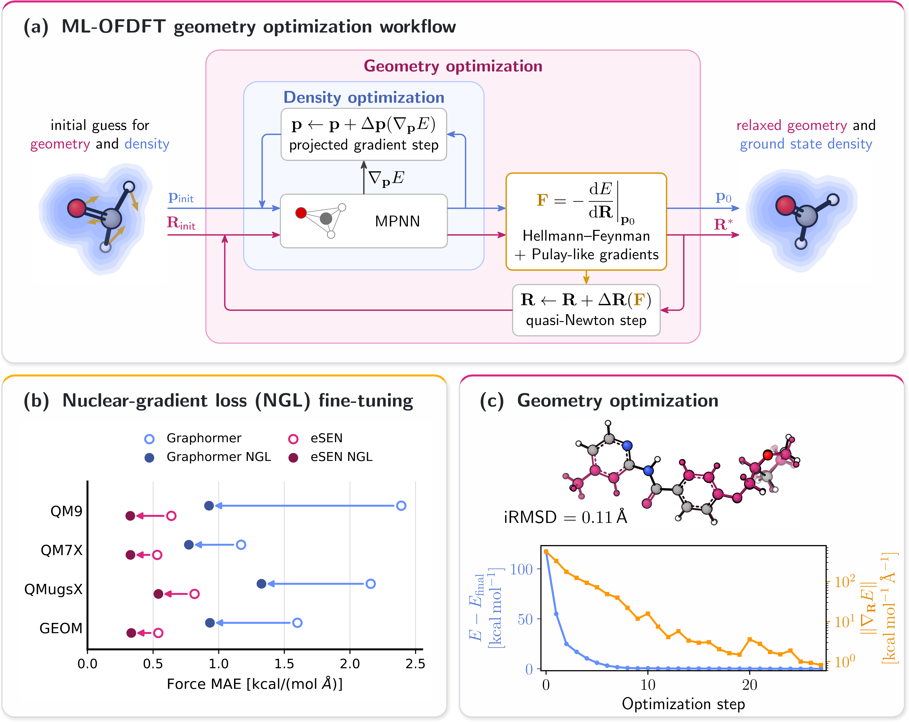

<div align="center">

# Analytic nuclear gradients for machine-learned orbital-free DFT

[](https://github.com/pre-commit/pre-commit)
[](https://pytorch.org/get-started/locally/)
[](https://pytorchlightning.ai/)
[](https://hydra.cc/)
[](https://black.readthedocs.io/en/stable/)
[](https://pycqa.github.io/isort/)

</div>



This repository provides data-generation, training, density-optimization, and geometry-optimization
workflows for developing and evaluating machine-learned orbital-free density functional theory
(ML-OFDFT).

## Quickstart

Clone the repository:

```bash
git clone git@github.com:sciai-lab/structures25-nuclear-gradients.git
cd structures25-nuclear-gradients
```

Install the GPU-enabled environment with [uv](https://docs.astral.sh/uv/):

```bash
uv sync --extra cuda --extra dev
```

For a CPU-only environment, replace `cuda` with `cpu`. Add the `docs` extra to build the
documentation.

Set the data and model directories before running the workflows:

```bash
export DFT_DATA="/path/to/data"
export DFT_MODELS="/path/to/models"
```

Trained model checkpoints are available on
[Hugging Face](https://huggingface.co/sciai-lab/structures25-nuclear-gradients).

## Usage

The main command-line entry points are:

- `mldft_ks`: generate Kohn-Sham DFT reference data
- `mldft_labelgen`: generate training labels
- `mldft_train`: train ML-OFDFT models
- `mldft_denop`: optimize electron densities
- `mldft_geomopt`: optimize molecular geometries

Activate the environment and run an entry point, for example:

```bash
source .venv/bin/activate
mldft_geomopt
```

The workflows are configured with [Hydra](https://hydra.cc/) through the configuration files in
[`configs`](configs).

Benchmark inputs, numerical results, and reproduction commands are provided in
[`evaluation`](evaluation).

## Documentation

Install the `docs` extra and build the documentation locally:

```bash
uv sync --extra cuda --extra docs
make docs
```

The generated documentation is available at `docs/build/html/index.html`.

## Third-party licenses

This code adapts code from the following third party libraries:

- [pytorch_geometric](https://github.com/pyg-team/pytorch_geometric)
- [equiformer_v2](https://github.com/atomicarchitects/equiformer_v2)

These are distributed under the

<details>
  <summary>MIT License</summary>
  <p>
    Permission is hereby granted, free of charge, to any person obtaining a copy
of this software and associated documentation files (the "Software"), to deal
in the Software without restriction, including without limitation the rights
to use, copy, modify, merge, publish, distribute, sublicense, and/or sell
copies of the Software, and to permit persons to whom the Software is
furnished to do so, subject to the following conditions:

The above copyright notice and this permission notice shall be included in all
copies or substantial portions of the Software.

THE SOFTWARE IS PROVIDED "AS IS", WITHOUT WARRANTY OF ANY KIND, EXPRESS OR
IMPLIED, INCLUDING BUT NOT LIMITED TO THE WARRANTIES OF MERCHANTABILITY,
FITNESS FOR A PARTICULAR PURPOSE AND NONINFRINGEMENT. IN NO EVENT SHALL THE
AUTHORS OR COPYRIGHT HOLDERS BE LIABLE FOR ANY CLAIM, DAMAGES OR OTHER
LIABILITY, WHETHER IN AN ACTION OF CONTRACT, TORT OR OTHERWISE, ARISING FROM,
OUT OF OR IN CONNECTION WITH THE SOFTWARE OR THE USE OR OTHER DEALINGS IN THE
SOFTWARE.

</p>
</details>
